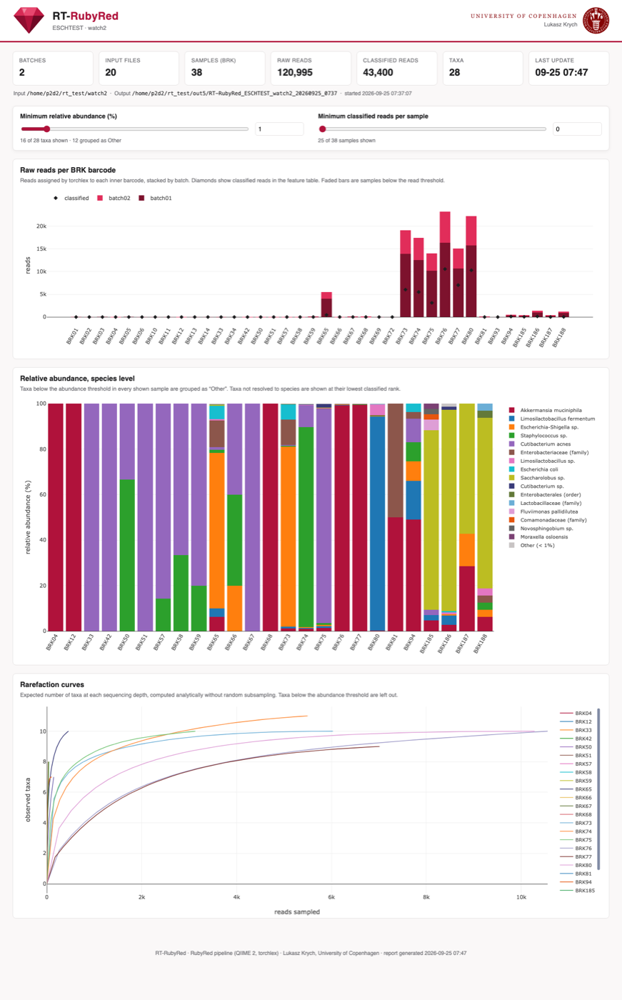

# RT-RubyRed

**Real-time rRNA amplicon classification for Oxford Nanopore sequencing runs.**

RT-RubyRed runs the [RubyRed](https://github.com/reillyeo/RubyRed) pipeline *while the sequencer is still running*. It watches the folder MinKNOW writes `*.fastq.gz` files into, analyses each new batch of files as it arrives, and keeps a merged feature table and an interactive HTML report up to date for the whole run (typically 70–110 hours).

```
██████╗ ████████╗    ██████╗ ██╗   ██╗██████╗ ██╗   ██╗██████╗ ███████╗██████╗
██╔══██╗╚══██╔══╝    ██╔══██╗██║   ██║██╔══██╗╚██╗ ██╔╝██╔══██╗██╔════╝██╔══██╗
██████╔╝   ██║ █████╗██████╔╝██║   ██║██████╔╝ ╚████╔╝ ██████╔╝█████╗  ██║  ██║
██╔══██╗   ██║ ╚════╝██╔══██╗██║   ██║██╔══██╗  ╚██╔╝  ██╔══██╗██╔══╝  ██║  ██║
██║  ██║   ██║       ██║  ██║╚██████╔╝██████╔╝   ██║   ██║  ██║███████╗██████╔╝
╚═╝  ╚═╝   ╚═╝       ╚═╝  ╚═╝ ╚═════╝ ╚═════╝    ╚═╝   ╚═╝  ╚═╝╚══════╝╚═════╝
```



## Contents

- [Features](#features)
- [How it works](#how-it-works)
- [Requirements](#requirements)
- [Installation](#installation)
- [Usage](#usage)
- [Output](#output)
- [The HTML report](#the-html-report)
- [Species-level classifier (database)](#species-level-classifier-database)
- [Resource limits](#resource-limits)
- [Testing without a sequencer](#testing-without-a-sequencer)
- [Citation, license and author](#citation-license-and-author)

## Features

- **Watches a MinKNOW output folder** and picks up new `*.fastq.gz` files as they appear. The folder is only read, never written: MinKNOW folders are owned by `minknow:minknow`.
- **Batch processing:** new files → [torchlex](https://nanoporetech.com/resource-centre/torchlex-method-real-time-demultiplexing-barcoded-oxford-nanopore-reads) demultiplexing on the inner barcodes (`BRK01`–`BRK192`) → RubyRed classification → one feature table per batch.
- **Merged feature table** of all batches, updated after every batch.
- **Interactive HTML report** in a single offline file:
  - raw reads per barcode
  - species-level relative abundance
  - rarefaction curves
  - live sliders for the abundance and read-count filters
- **Per-taxon read files** (`rep_seqs/<taxon>.fasta.gz`) with read IDs that are unique across batches.
- **Species-level classifier**: a cleaned version of the MIMt 16S database that reports species instead of strains and fixes inconsistent lineages. See [below](#species-level-classifier-database).
- **Safe to run next to MinKNOW:** it uses at most 50% of CPU cores (hard pinning) and 50% of RAM (cgroup limit), at low CPU and I/O priority.
- **Stop at any time with Ctrl-C:** the per-batch `BRKxx.fastq` files are joined into one file per barcode and the batch folders are removed. `--resume` continues an interrupted run.

## How it works

```
MinKNOW  ──>  watch folder (*.fastq.gz, read-only)
                    │  every 60 s: files not yet in input_file_index.tsv
                    ▼
            torchlex demultiplexing ──> fastq_demultiplexed/batchNN/BRKxx.fastq
                    ▼
            RubyRed (QIIME 2): length/quality filter, chimera removal,
            orientation, sklearn classification (species-level classifier)
                    ▼
            feature_tables/feature_table_batchNN.tsv
            rep_seqs/<taxon>.fasta.gz  (reads appended, IDs BRKxx_bNN_n)
                    ▼   (from batch 2 on)
            <run>_<dir>_<date>_feature_table.tsv   (all batches merged)
            <run>_<dir>_<date>_report.html         (rebuilt every batch)
```

When a batch finishes, the tool checks the folder again and processes only the files that arrived in the meantime. A file is added to the index only after its batch has completed. If a batch is interrupted, its files are therefore picked up again later, and no file is analysed twice.

Example terminal output:

```
  Run          ONT_250925_16S
  Watching     /data/ONT_250925_16S/.../fastq_pass/barcode94  (owned by minknow:minknow; read-only use)
  Results      /home/user/Desktop/RT-RubyRed_ONT_250925_16S_barcode94_20260925_0737
  Resources    16/32 cores (pinned 16-31), RAM cap 62.5G of 124.9G (cgroup enforced), nice 10 / ionice idle-ish
  Classifier   MIMt_16s_311025_species_classifier.qza
[07:37:17] ▶ batch01: 10 new file(s) (84.0M) → torchlex demultiplexing
[07:37:22]    torchlex: 86,575 reads assigned to 37 BRK barcode(s)
[07:37:22]    RubyRed classification (16 threads)…
[07:43:36] ✔ batch01 done in 6.3 min: 30,821 reads added to the feature table (run total 30,821)
             input : /data/ONT_250925_16S/.../fastq_pass/barcode94
             output: /home/user/Desktop/RT-RubyRed_ONT_250925_16S_barcode94_20260925_0737
             table : feature_tables/feature_table_batch01.tsv
```

## Requirements

- Linux (tested on Ubuntu 22.04).
- [RubyRed](https://github.com/reillyeo/RubyRed) installed with its `qiime2` conda environment. That environment must contain `qiime` (tested with QIIME 2 2024.5 and 2024.10, scikit-learn 1.4.2), `torchlex`, `cutadapt`, `chopper`, `vsearch`, `seqkit`, GNU `parallel` and `biom`, plus Python packages `pandas` and `psutil`.
- `systemd-run` (standard on Ubuntu) to enforce the RAM limit. Without it the tool still runs, but the RAM limit is not enforced.

## Installation

### 1. RubyRed and its conda environment

Follow the [RubyRed installation instructions](https://github.com/reillyeo/RubyRed). RT-RubyRed expects RubyRed in `~/my_scripts/RubyRed`; for another location, set `RUBYRED_HOME`:

```bash
export RUBYRED_HOME=/path/to/RubyRed      # e.g. in ~/.bashrc
```

Check that the environment has everything RT-RubyRed needs:

```bash
conda activate qiime2
for c in qiime torchlex cutadapt chopper vsearch seqkit parallel biom; do command -v $c >/dev/null && echo "ok  $c" || echo "MISSING  $c"; done
python -c "import pandas, psutil; print('ok  pandas, psutil')"
```

### 2. RT-RubyRed

```bash
mkdir -p ~/my_scripts && cd ~/my_scripts
git clone https://github.com/krychu84/RT-RubyRed.git
chmod +x RT-RubyRed/RT-RubyRed
echo 'export PATH="$HOME/my_scripts/RT-RubyRed:$PATH"' >> ~/.bashrc
source ~/.bashrc
RT-RubyRed -v
```

The launcher activates the `qiime2` environment itself. It finds conda in `~/miniforge3`, `~/miniconda3` or `~/anaconda3`; for any other location, set `CONDA_BASE=/path/to/conda`.

### 3. Species-level classifier (recommended)

Download `MIMt_16s_311025_species_classifier.qza` and `MIMt_16s_311025_species_tax.qza` from the [latest release](https://github.com/krychu84/RT-RubyRed/releases/latest), and install them next to RubyRed's original MIMt classifier:

```bash
D=${RUBYRED_HOME:-~/my_scripts/RubyRed}/resources/classifiers
mkdir -p $D/MIMt_16s_311025_species && cd $D/MIMt_16s_311025_species
mv ~/Downloads/MIMt_16s_311025_species_{classifier,tax}.qza .
# the reference sequences are unchanged: link the original ones
ln -s ../MIMt_16s_311025/MIMt_16s_311025_seqs.qza MIMt_16s_311025_species_seqs.qza
```

Or build it yourself from the original MIMt classifier, which takes about 1 minute and needs about 9 GB of RAM (see [database/README.md](database/README.md)):

```bash
conda activate qiime2
D=${RUBYRED_HOME:-~/my_scripts/RubyRed}/resources/classifiers
mkdir -p $D/MIMt_16s_311025_species
python ~/my_scripts/RT-RubyRed/database/make_species_classifier.py \
       $D/MIMt_16s_311025 $D/MIMt_16s_311025_species/MIMt_16s_311025_species
ln -s ../MIMt_16s_311025/MIMt_16s_311025_seqs.qza $D/MIMt_16s_311025_species/MIMt_16s_311025_species_seqs.qza
```

RT-RubyRed uses this classifier automatically when it is present. If it is not installed, RT-RubyRed prints a warning and falls back to RubyRed's default classifier.

*Optional:* to make plain `RubyRed` use it by default as well, point the three default paths in the `RubyRed` script (`reference_seqs`, `reference_taxonomy`, `classifier`) to the `MIMt_16s_311025_species` folder.

## Usage

Run it inside `tmux` or `screen`, so it keeps running if your SSH connection drops:

```bash
tmux new -s rt
RT-RubyRed -w /data/<experiment>/<sample>/<flowcell_run>/fastq_pass/barcodeNN
```

- Detach: `Ctrl-b` then `d`. Re-attach: `tmux attach -t rt`.
- **Stop and finalise:** `Ctrl-C`.

Examples:

```bash
# set the run name yourself (default: MinKNOW experiment name from the path)
RT-RubyRed -w .../fastq_pass/barcode94 -n GUT_STUDY_01

# finalise automatically 3 h after the last new file appeared
RT-RubyRed -w .../fastq_pass/barcode94 --idle-stop 3

# continue a run that was stopped or crashed (same results folder)
RT-RubyRed -w .../fastq_pass/barcode94 --resume ~/Desktop/RT-RubyRed_<...>

# your own RubyRed filters, or the original (strain-level) classifier
RT-RubyRed -w .../fastq_pass/barcode94 --rubyred-args "-q 12 -l 900 -x 1500"
RT-RubyRed -w .../fastq_pass/barcode94 --classifier original
```

| Option | Default | Description |
|---|---|---|
| `-w, --watch DIR` | *(required)* | Folder with the incoming `*.fastq.gz` files |
| `-n, --name NAME` | from path | Run name |
| `-o, --outdir DIR` | `~/Desktop` | Where the results folder is created |
| `--resume DIR` | | Continue an earlier RT-RubyRed results folder |
| `--poll SEC` | 60 | Seconds between checks for new files |
| `--settle SEC` | 60 | Skip files modified in the last SEC seconds (still being written) |
| `--min-files N` | 1 | Minimum number of new files to start a batch |
| `--idle-stop HOURS` | 0 (never) | Finalise after HOURS without new files |
| `-R, --recursive` | off | Also look in sub-folders of the watch folder |
| `--cpu-frac F` | 0.5 | Share of CPU cores to use |
| `--mem-frac F` | 0.5 | Share of RAM to allow |
| `--classifier DIR` | species classifier | Classifier folder; `original` = RubyRed's own default |
| `--subsample N` | no subsampling | RubyRed `-t` per batch |
| `--rubyred PATH` | `$RUBYRED_HOME/RubyRed` | RubyRed script |
| `--rubyred-args "..."` | | Extra RubyRed options (`-q`, `-l`, `-x`, `-c`, `-z` …) |
| `--barcodes FASTA` | RubyRed's | torchlex barcode file |

A batch takes about 2–6 minutes on a 32-core machine. Most of that time is spent in RubyRed's sklearn classification step.

## Output

```
~/Desktop/RT-RubyRed_<run>_<dir>_<YYYYMMDD_HHMM>/
├── <run>_<dir>_<date>_feature_table.tsv   merged feature table (all batches)
├── <run>_<dir>_<date>_report.html         interactive report (single offline file)
├── input_file_index.tsv                   every input file analysed, with its batch
├── batch_stats.json                       raw reads per BRK barcode and per batch
├── RT-RubyRed.log                         what was shown in the terminal
├── run_meta.json                          run settings
├── fastq_demultiplexed/
│   ├── batch01/ batch02/ …                during the run
│   └── BRK01.fastq BRK02.fastq …          after Ctrl-C (batches joined)
├── feature_tables/feature_table_batchNN.tsv
├── rep_seqs/<taxon>.fasta.gz              classified reads per taxon, all batches
├── rubyred_batches/batchNN/               RubyRed output per batch (log, rep_seqs, qzv)
└── logs/batchNN.log, batchNN_files.txt    full torchlex/RubyRed output, input list
```

- `<run>` is the MinKNOW experiment name (or `-n`); `<dir>` is the watched folder (e.g. `barcode94`).
- RubyRed numbers reads from 1 in every batch. In `rep_seqs/`, read IDs therefore carry the batch number (`>BRK185_b02_89`), so they are unique across batches. The part before the first `_` is the sample.
- Low-frequency taxa are not removed per batch (RubyRed `-f 1`). Use the abundance slider in the report instead.

## The HTML report

A single self-contained HTML file (plotly.js is embedded, so it works offline). It is rebuilt after every batch; re-open it to see the latest data.

- **Summary tiles:** batches, input files, samples, raw and classified reads, taxa.
- **Minimum relative abundance** (slider plus number box): taxa below the threshold in every shown sample are grouped as *Other* in the barchart and left out of the rarefaction curves.
- **Minimum classified reads per sample** (slider plus number box): hides samples with too few reads.
- **Raw reads per BRK barcode:** stacked by batch, with classified reads as markers.
- **Relative abundance at species level:** taxa not resolved to species are shown at their lowest classified rank, e.g. *Staphylococcus sp.* or *Enterobacteriaceae (family)*.
- **Rarefaction curves per sample:** expected richness computed analytically (Hurlbert), without random subsampling.

All plots update when either slider moves, and every plot can be downloaded as SVG.

## Species-level classifier (database)

Most species labels in the MIMt 16S reference database carry a strain name (e.g. `S__Escherichia_coli_strain_JCM_1649`), and some taxa appear under two names or two lineages. QIIME's `classify-sklearn` works down the ranks and stops at the first rank where no single name reaches the confidence threshold (0.9). Both problems split the probability and make reads stop too early. For example, *Akkermansia* reads stopped at **phylum** because the database had the class both as *Verrucomicrobiae* and as *Verrucomicrobiia*.

`database/make_species_classifier.py` fixes the labels **without retraining**: every reference keeps its trained k-mer profile, and only the taxonomy labels are corrected.

1. **Lineage clean-up at all ranks:**
   - synonyms and spelling variants are unified (e.g. *Euryarchaeota* → *Methanobacteriota*, *Verrucomicrobiae* → *Verrucomicrobiia*)
   - species names that use a misspelled or older genus name are corrected
   - every taxon is given a single parent lineage
2. **Species instead of strains:**
   - strain names, culture-collection numbers, *subsp.* and isolate codes are removed
   - where a species has several references, the strain moves to an 8th rank (`…;S__Escherichia_coli;T__JCM_1649`), so the classifier adds up the probability of all its strains
   - RubyRed collapses the table at level 7, so strains never appear in the results
3. **Species 16S cannot separate:**
   - *Akkermansia massiliensis* and *A. biwaensis* are reported as *A. muciniphila*
   - *Escherichia* and *Shigella* become one genus, *Escherichia-Shigella* (as in SILVA); *Shigella* species are reported as *E. coli*

Effect on 49,775 reads from a 16S run (original → cleaned classifier, same reads):

| Classified to | original | cleaned |
|---|---|---|
| species | 8.3 % | **41.5 %** |
| genus | 58.8 % | 44.7 % |
| above genus | 32.9 % | **13.8 %** |
| reads stopping at phylum | 9,544 | **1** |

No read became less specific. Reads that remain at a high rank (e.g. class *Bacilli*) were mostly PCR chimeras: one half of the read from one genus, the other half from another.

Details, the full list of changes and how to add your own species merges: [database/README.md](database/README.md).

## Resource limits

RT-RubyRed is meant to run on the sequencing computer during the run, so it limits itself:

- **CPU:** the process and all its children are pinned to half of the cores (`--cpu-frac`), which is a hard limit.
- **RAM:** each torchlex/RubyRed step runs in a `systemd-run --user --scope` with `MemoryMax` = 50% of RAM (`--mem-frac`) and no swap.
- **Priority:** `nice 10` and `ionice -c2 -n7`.
- **Monitoring:** CPU and RAM use are shown in the terminal every 30 s while a batch runs.

## Testing without a sequencer

`test/simulate_run.sh` copies fastq.gz files into a folder in batches, the way MinKNOW writes them. Run it in one terminal and RT-RubyRed in another:

```bash
# terminal 1: 10 files every 2 minutes
test/simulate_run.sh /path/to/existing/fastq_pass/barcodeNN /tmp/rt_watch 10 120
# terminal 2
RT-RubyRed -w /tmp/rt_watch -n TEST -o /tmp/rt_out --poll 20 --settle 5
```

## Citation, license and author

- **Author:** Lukasz Krych, University of Copenhagen, Department of Food Science.
- **RT-RubyRed** is released under the [MIT License](LICENSE). If you use it, please also cite RubyRed, QIIME 2 and the MIMt database.
- **Built on:**
  - [RubyRed](https://github.com/reillyeo/RubyRed)
  - [QIIME 2](https://qiime2.org)
  - [torchlex](https://nanoporetech.com/resource-centre/torchlex-method-real-time-demultiplexing-barcoded-oxford-nanopore-reads)
  - [scikit-learn](https://scikit-learn.org)
  - [plotly.js](https://plotly.com/javascript/) (MIT, bundled in `assets/`)
- The University of Copenhagen seal in the report belongs to the University of Copenhagen.
